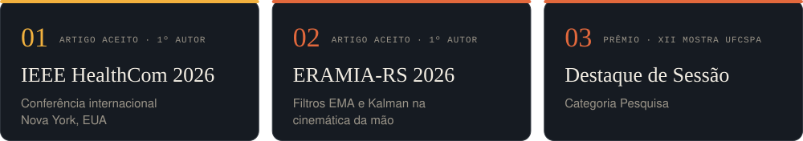
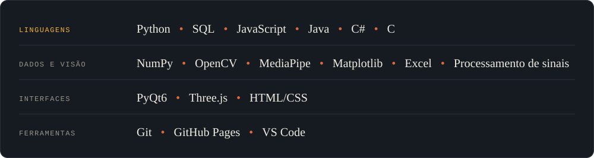

  

  &nbsp;
  &nbsp;
  

 

Sou estudante de **Informática Biomédica na UFCSPA** e pesquisador no laboratório **NERV**. Desenvolvo um sistema que mede os movimentos dos dedos com uma webcam comum para apoiar a reabilitação após AVE. O trabalho vai da captura por visão computacional até a filtragem do sinal e a análise dos dados. Também sou estagiário em **análise de dados epidemiológicos** no Centro Estadual de Vigilância em Saúde (RS).

**Busco estágio ou vaga júnior como desenvolvedor ou analista de dados.** Porto Alegre, híbrido ou remoto.

 

  

## Projetos

<table>
  <tr>
    <td width="50%" valign="top">
      
      <i>Fig. 02 — Interface do sistema: pontos da mão, métricas e amplitude total por dedo.</i>
      <h3>Avaliação cinemática da mão</h3>
      
Goniometria dos dedos em tempo real com uma webcam: detecta 21 pontos da mão, calcula os ângulos articulares, filtra o ruído do sinal e exporta CSV e relatório em PDF.

      
<code>Python</code> <code>MediaPipe</code> <code>OpenCV</code> <code>NumPy</code> <code>PyQt6</code>

      
<a href="https://github.com/Fidelis-Leandro/computer-vision-based-hand-kinematic-assessment"><b>Ver repositório →</b></a>

    </td>
    <td width="50%" valign="top">
      
      <i>Fig. 03 — Laboratório: mão em 3D e o sinal antes e depois de cada cadeia de filtros.</i>
      <h3>Hand Filter Lab</h3>
      
Laboratório interativo no navegador que compara 7 filtros de suavização sobre dados de movimento da mão, com modelo 3D, aula guiada e análises de Bland-Altman e Pareto.

      
<code>JavaScript</code> <code>Three.js</code> <code>MediaPipe</code> <code>Processamento de sinais</code>

      
<a href="https://fidelis-leandro.github.io/hand-filter-lab/"><b>Abrir demo →</b></a> · <a href="https://github.com/Fidelis-Leandro/hand-filter-lab">Repositório</a>

    </td>
  </tr>
</table>

## Tecnologias

  

